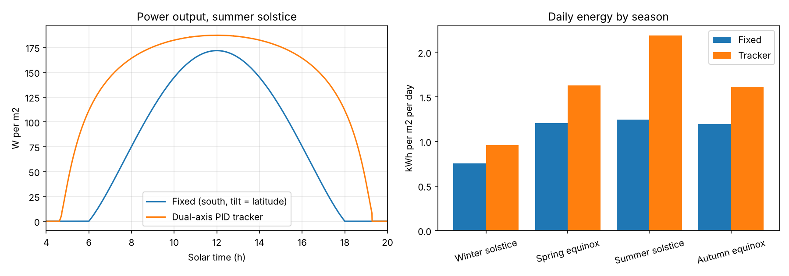
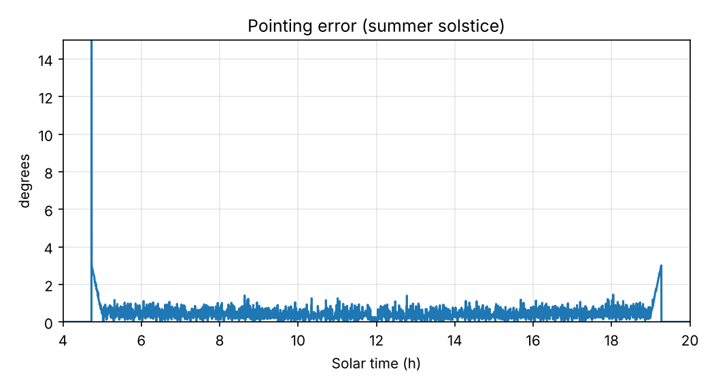

# HelioTrack: dual-axis solar tracker


A complete mechatronics project in one repository: **solar geometry model, PID control, noisy-sensor simulation, Arduino/ESP32 firmware, tests, CI and a hardware guide.** The simulation runs on any laptop, and the firmware targets a ~25 USD build.



## Why this project

A fixed panel only faces the sun well for a few hours. A tracker keeps the panel perpendicular to the sun all day. HelioTrack covers every layer of the problem:

| Layer | What's here |
|---|---|
| Mechanical | Pan/tilt geometry, travel limits, night park position |
| Electrical | 4-LDR quadrant sensor, voltage dividers, servo power ([docs/hardware.md](docs/hardware.md)) |
| Embedded | Arduino/ESP32 firmware with filtering, PID, slew limit, telemetry ([firmware/](firmware/helio_track/helio_track.ino)) |
| Control | PID with anti-windup, deadband and output saturation ([controller.py](solartracker/controller.py)) |
| Software | Python package, CLI, unit tests, GitHub Actions CI |

## Quick start

```bash
git clone https://github.com/<your-username>/helio-track.git
cd helio-track
pip install -r requirements-dev.txt
pytest -q
python -m solartracker --lat 41.0 --plot     # results saved to results/
```

Options: `--lat` (latitude), `--noise` (sensor noise in degrees).

## Results

Simulated at 41° N (Istanbul), 1 m² panel, 20% efficiency, 5 s control period, 0.5° sensor noise:

| Day | Fixed panel (kWh) | Tracker (kWh) | Gain |
|---|---:|---:|---:|
| Winter solstice | 0.75 | 0.96 | +27% |
| Spring equinox | 1.20 | 1.63 | +35% |
| Summer solstice | 1.24 | 2.19 | +76% |
| Autumn equinox | 1.20 | 1.61 | +35% |

Median pointing error while tracking (08:00-16:00): **about 0.35°**, 95th percentile under 1°.



## How it works

1. **Sun model** ([sun.py](solartracker/sun.py)): declination (Cooper), hour angle, then azimuth/elevation. Clear-sky direct irradiance uses the Meinel air-mass model. Panel power is `DNI x cos(incidence) x area x efficiency`.
2. **Sensor**: the controller sees the angular error plus Gaussian noise, like an LDR quadrant sensor does.
3. **Controller**: one PID per axis outputs an angular rate, limited to 3°/s (servo + gearbox). A 1° deadband stops jitter and saves energy; anti-windup stops the integrator saturating.
4. **Night**: the tracker returns to a park position facing sunrise.

## Engineering notes

- **Tuning bug caught by a test:** the first gains (`kp = 0.8`) gave `kp x dt = 4` for a rate-command loop, which is unstable in discrete time. Pointing error was ~9° median. Reducing the gain so `kp x dt < 1` brought it to ~0.35°. The regression is guarded by `test_pointing_error_stays_small_while_tracking`.
- Firmware and simulation share the same control structure, so gains can be transferred after unit conversion.

## Limitations (honest ones)

- Direct beam only, clear sky, no diffuse light, clouds, temperature or panel soiling. Real annual gains from dual-axis tracking are typically lower than the idealised figures above, especially on cloudy days.
- The plant is an ideal rate-limited actuator (no backlash, wind load or servo dynamics).
- Energy used by the motors is not subtracted.
- The firmware was written to match the simulation but **has not been validated on physical hardware yet**; see the bring-up checklist in the hardware guide.

## Roadmap

- [ ] Validate firmware on a real build and publish measured logs
- [ ] Add sun-position feed-forward (astronomical tracking) combined with LDR feedback
- [ ] Cloud/diffuse model and motor energy cost
- [ ] Wind stow logic
- [ ] CAD files for the pan/tilt bracket

## Repository layout

```
solartracker/   Python package (sun model, PID, simulation, CLI)
tests/          pytest unit tests
firmware/       Arduino/ESP32 sketch
docs/           hardware guide, LinkedIn post drafts
results/        generated plots
```

## License

MIT. See [LICENSE](LICENSE).
